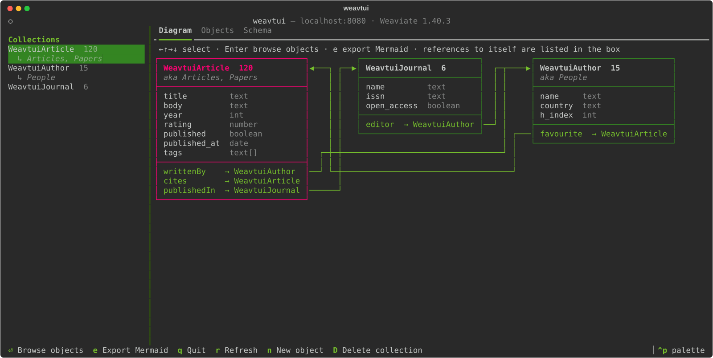
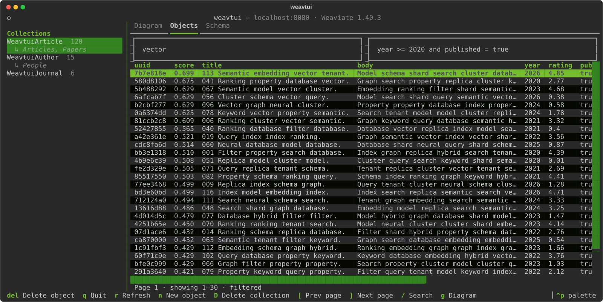
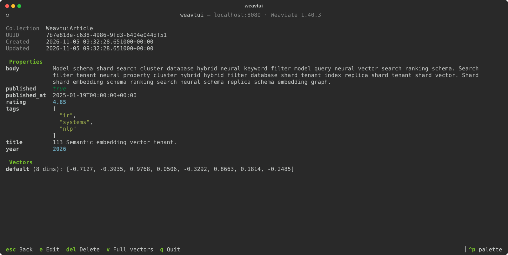
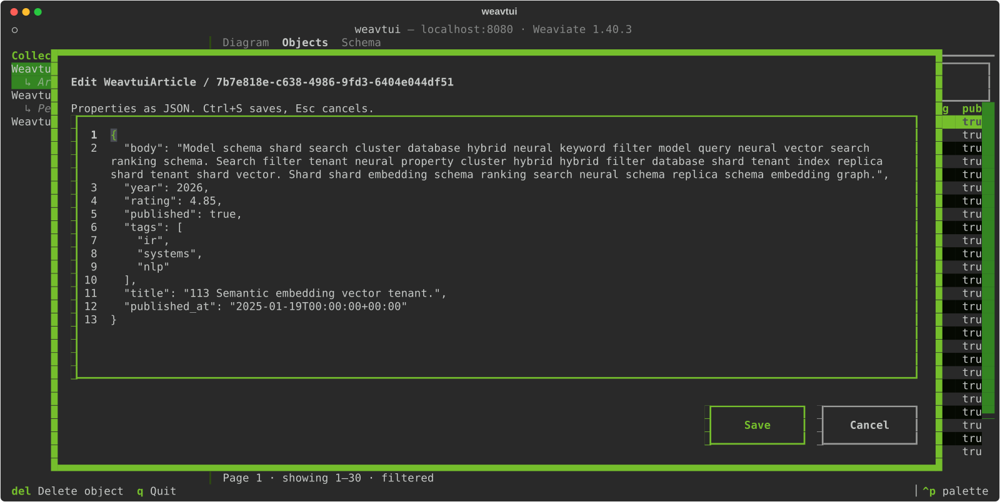
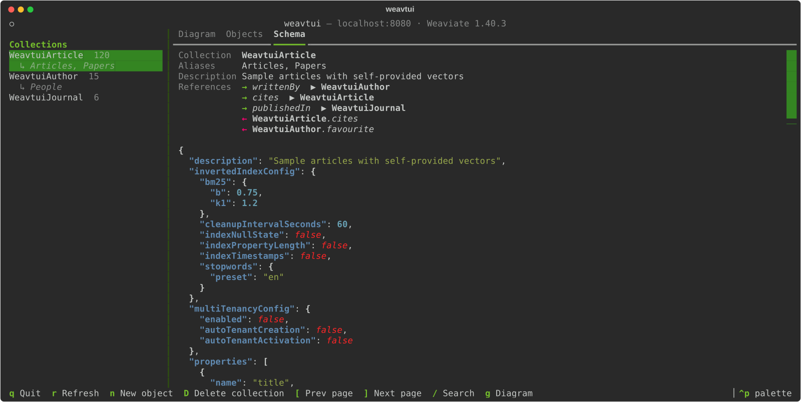

# weavtui

**A terminal UI for exploring [Weaviate](https://weaviate.io) databases.** See your schema
as a diagram, browse and search objects, inspect vectors and edit data, all from the
terminal. Built with [Textual](https://github.com/textualize/textual).



## Features

- **Schema diagram**: every collection as a UML-like box with its properties, types,
  aliases and object count, with arrows for cross-references. Export it as Mermaid.
- **Object browser**: page through any collection; pages size themselves to your window.
- **Search and filters**: keyword (BM25) search plus simple property filters such as
  `year >= 2020 and published = true`.
- **Object details**: all properties, metadata and vectors.
- **Editing**: create, edit (as JSON) and delete objects; delete whole collections, with
  confirmation.
- **Fits your terminal**: no background of its own; uses your terminal's colours plus
  Weaviate green.

| Browse and search | Inspect an object |
| --- | --- |
|  |  |
| **Edit as JSON** | **Schema and references** |
|  |  |

## Installation

weavtui needs Python 3.13 or newer. The easiest way is to install it as a standalone tool
with [uv](https://docs.astral.sh/uv/) or [pipx](https://pipx.pypa.io/); uv downloads a
suitable Python automatically if you don't have one.

```bash
uv tool install weavtui     # or: pipx install weavtui
weavtui
```

Try it without installing:

```bash
uvx weavtui
```

Or install it into an existing environment:

```bash
pip install weavtui
```

## Usage

```bash
weavtui                                   # localhost:8080, gRPC 50051, no auth
weavtui --port 8180 --grpc-port 50151     # another local instance
weavtui --host db.example --api-key "$KEY"
weavtui --start browse                    # open the object browser instead of the diagram
```

| Option | Environment variable | Default |
| --- | --- | --- |
| `--host` | `WEAVTUI_HOST` | `localhost` |
| `--port` | `WEAVTUI_PORT` | `8080` |
| `--grpc-port` | `WEAVTUI_GRPC_PORT` | `50051` |
| `--api-key` | `WEAVTUI_API_KEY` | none |
| `--start` (`diagram` or `browse`) | `WEAVTUI_START` | `diagram` |

weavtui works with Weaviate 1.x through the v4 Python client and is tested against
Weaviate 1.40. Aliases need Weaviate 1.32 or newer; on older servers they're simply not
shown.

### The layout

The collection list on the left is always visible. On the right are three tabs:

- **Diagram**: the schema of the whole database.
- **Objects**: the selected collection's objects.
- **Schema**: the selected collection's full configuration, aliases and references.

### Keys

| Key | Where | Action |
| --- | --- | --- |
| `g` | anywhere | Go to the diagram |
| `←` `→` `↑` `↓` | diagram | Select a collection (the list on the left follows) |
| Click | diagram | Select a collection; click it again to browse its objects |
| `Enter` | diagram | Browse the selected collection's objects |
| `e` | diagram | Export the schema as a Mermaid `classDiagram` (asks where to save; also copied to the clipboard) |
| `Enter` | objects | Open the selected object |
| `[` `]` | objects | Previous / next page |
| `/` | objects | Keyword search |
| `n` | anywhere | New object in the current collection |
| `Del` | objects | Delete the selected object |
| `D` | anywhere | Delete the current collection (asks you to type its name) |
| `r` | anywhere | Refresh |
| `Ctrl+P` | anywhere | Command palette, e.g. to switch to the `weaviate-light` theme |
| `q` | anywhere | Quit |

In the object view: `e` edit, `Del` delete, `v` show full vectors, `Esc` back.
The editor takes the properties as JSON; `Ctrl+S` saves, `Esc` cancels.

### Filters

Conditions joined with `and`. Values are converted using the property's type from the
schema.

```
year >= 2020 and published = true
title like "*vector*"
tags contains nlp, ml
published_at > 2024-01-01
```

Operators: `=` `!=` `<` `<=` `>` `>=` `like` `contains` (matches any of the
comma-separated values).

### Limitations

- Multi-tenant collections aren't supported yet (no tenant picker).
- Cross-reference *values* aren't shown on objects yet; the diagram shows which
  collections can reference which.
- Vectors can be viewed but not edited, and there is no vector search yet.

## Development

```bash
git clone https://github.com/mdocekal/weavtui && cd weavtui
uv sync
docker compose up -d                       # Weaviate 1.40.3 on localhost:8080 / 50051
uv run python scripts/seed.py              # sample collections, aliases and references
uv run weavtui
uv run pytest                              # integration tests are skipped without Weaviate
uv run ruff check . && uv run ruff format .
```

- `uv run textual run --dev -c weavtui` together with `uv run textual console` gives you
  Textual's debug console.
- `uv run python scripts/screenshots.py` regenerates the images in `docs/images`; it needs
  the seeded database and Inkscape.
- To use another server version or other ports:
  `WEAVIATE_VERSION=1.39.15 WEAVIATE_HTTP_PORT=18080 WEAVIATE_GRPC_PORT=15051 docker compose up -d`
  (set `WEAVTUI_TEST_PORT` / `WEAVTUI_TEST_GRPC_PORT` for the tests).

See [AGENTS.md](https://github.com/mdocekal/weavtui/blob/main/AGENTS.md) for the code layout and conventions.

### Releasing to PyPI

```bash
uv version --bump patch        # or minor / major; commit the change
scripts/publish.sh --test      # TestPyPI first (token in UV_PUBLISH_TOKEN)
scripts/publish.sh             # PyPI
```

The script checks that the working tree is clean and the version isn't tagged yet. It
then runs lint and tests, builds, smoke-tests the wheel in a clean environment, checks
the package metadata, uploads, and tags the release (`vX.Y.Z`); pushing the tag is left
to you.

## License

Released into the public domain under [The Unlicense](https://github.com/mdocekal/weavtui/blob/main/LICENSE).
